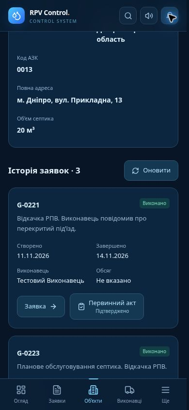

# Canonical object passports and order history

Each passport owns only applications with its canonical `customer_site_id`. The history API does not combine records by text, station number, or network at read time.

The migration consolidates existing exact network + region + station-code duplicates. It retains the passport with the most applications, uses the most frequent address/capacity pair, moves any linked applications/publication metadata, and records original rows and moved links in the private event journal. Superseded passport rows remain as aliases, so old office URLs resolve to the retained passport. Original acts, files, completed work and statuses remain unchanged.

Only active passports appear in office/bot lists and the existing authorized customer view. A unique active identity index prevents new duplicates. Repeat registration reuses an object only for a manager who already has access. A different manager must obtain access from the office and cannot claim another object's history by entering its code.

Office passport history is paginated with an exact total and includes completed, active and cancelled orders. Each card shows actual completion history and links to the application and its primary acts. Missing volume remains unknown rather than becoming zero. The endpoint uses the existing office JWT and role checks; customer access boundaries remain enforced.

Validation: the database regression exercises merge preservation, exact object isolation, old aliases, duplicate prevention and denied unauthorized claims. API tests cover office roles, pagination, missing objects and errors. Mobile browser checks open the correct order and act from a passport. The screenshot contains synthetic data only.

