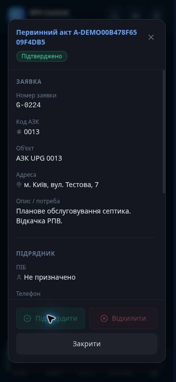

# Primary act registration and completion

Office uploads previously saved only `application_files`; completion reviewed `acts`.
The drawer's Finish action also showed a static warning without reviewing an act.

An `act` attachment now registers an act and its `act_files` row in the same database transaction.
Uploads for one pending application share the pending act; application row locking serializes uploads.
The migration registers existing orphan primary attachments without approving work or changing payouts.

Finish reads the current registry, calls the existing authenticated office approval handler,
then checks that the application was committed as completed. Approval retains the existing
`rpv_service_review` history, bot status updates and notifications. No status guard is bypassed.
Unknown work date or volume is not inferred from upload time. As with legacy bot acts without
a service report, customer publication still needs the existing explicit date/volume publication flow.

## Where documents remain available

- Office: **Ще → Первинні акти** (pending, approved and rejected records).
- Application: **Первинний акт**, with the approval and completion events in **Таймлайн**.
- Object passport: linked applications lead to their acts and work history.
- Customer: approved and explicitly published acts in **Мої акти**, with the existing monthly archive and object access checks.

Web originals remain in the private `application-media` Storage bucket. Metadata and links live in
`application_files`, `act_files`, `acts`; review events and work records remain in the database.
Existing Telegram originals are retained by file ID and remain readable. This change does not
claim to migrate all Telegram binaries into Storage or provide an off-site backup.
Office viewers use signed Storage links. Bot opening supports both original sources. Customer
download proxies authorized private bytes and preserves the original filename/extension.
Primary originals cannot be removed or overwritten through the browser Storage policies;
the attachment delete button is not shown for primary acts. Completed work cannot accept a
replacement upload; corrections require the existing rejection/review process before acceptance.

## Validation

PGlite tests execute the actual migration and review functions: orphan repair, multiple pages,
idempotency, role denial, path ownership, completed history and private original retention.
The real frontend completion API is tested for missing acts, failed review, missing commit,
current auth and repeated completion. Bot source resolution covers Storage and Telegram files.
The synthetic mobile browser scenario exercises the real Finish button and retained act link.

## Office acts without an assigned contractor

Production still required `work_history.contractor_id`, so accepting an office-uploaded act
without an assigned contractor rolled back during history insertion. The follow-up migration
allows the existing NULL identity; it does not invent a contractor, skip history, or approve
any records. Approval still uses the same authenticated review transaction and status guards.

The regression fixture now reproduces the production NOT NULL constraint, proves the failed
review leaves the act pending, then applies the migration and verifies completed work, the
retained original, NULL contractor, and exactly one history record after a repeated review.

The 360 px browser fixture (`tests/act-review-mobile.html`) covers an unassigned contractor,
long act number, a failed review with an inline error, and a successful retry. All three footer
buttons fit the dialog; approved acts disable further approval/rejection. Backend error bodies
are shown inside the dialog. The screenshot uses synthetic records only.

