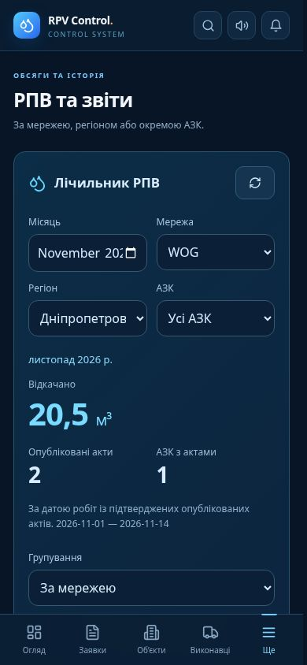

# Office RPV counter and reports

The office overview, object passport and **РПВ та звіти** use the same approved, published act source as the manager counter. Work dates determine the month in Europe/Kyiv; future work dates are excluded. Only one published record per application is summed, regardless of how many managers have access.

Filters: month → network → region → station. Region comes from the object passport city catalog, not the contractor. Reports group by network, region or station; CSV exports every matching group in one database snapshot. Zero-volume sites remain discoverable. Previous months remain available.

The RPC and source view are service-role-only. The portal validates the active office role before reads or exports. Existing manager visibility restrictions remain unchanged.

Validation: complete portal regression suite, TypeScript, production build and Deno check passed. SQL tests cover precise decimals, rejected/unpublished/future acts, duplicate manager grants, individual station isolation, monthly history, more than 1,000 stations and full CSV exports. Browser QA covers 390 px layout, cascading filters, month archive, zero results, CSV download and retry after a failed request.

The screenshot uses synthetic records; it contains no production customer data.
